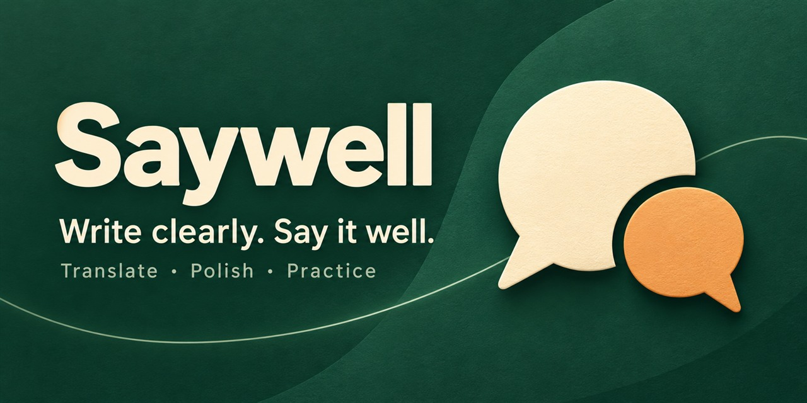
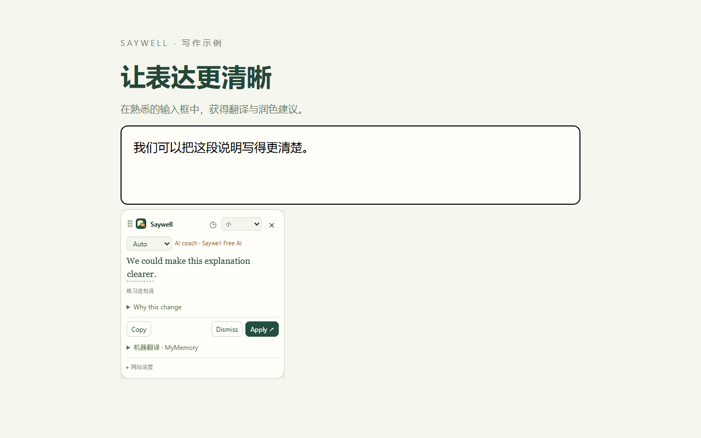

# Saywell

**[简体中文](README.md) · English**

Translate and polish where you type.

Unsure how to phrase an English message? Write your thought in Chinese, or draft in English, and pause for a suggestion. Keep the original, copy the result or choose Apply. Saywell never sends the message for you.

For Chrome and Edge. **This is a preview.** Start with the GitHub installation package below.

## Install and start writing

1. Download `saywell-VERSION.zip` from [Releases](https://github.com/ider-zh/saywell/releases), rather than Source code. If no version has been released yet, or you want the latest changes, open [preview builds](https://github.com/ider-zh/saywell/actions/workflows/build.yml), select a successful build and download the package under **Artifacts**; that download requires GitHub sign-in.
2. Extract it into a folder you intend to keep.
3. Open `chrome://extensions` in Chrome or `edge://extensions` in Edge. Enable **Developer mode**, select **Load unpacked**, and choose the folder containing `manifest.json`.
4. Read the welcome disclosure, select **Agree and enable Saywell**, and approve website access.
5. Type a sentence in an ordinary website input and pause. Refresh an already open page if needed.

**Basic free AI needs no account or API key: one permission action gets you started.** If access is declined, the toolbar shows `!` with a retry action. You can also enable individual sites from Settings or the popup.

## Translate, polish and choose what to use

- **Chinese/English translation:** English is the initial target. Change it using the Saywell toolbar popup.
- **Clearer phrasing:** Writing in the target language automatically offers polishing. The tooltip also lets you choose Translate, Polish or Explain.
- **Results as they arrive:** Available browser-local MT or separately connected MT can run alongside AI. Once AI finishes, earlier MT folds away and remains available to expand.
- **Explicit replacement:** Only Apply replaces the draft. Older suggestions cannot overwrite changed input; complex editors may offer Copy instead.

Use **Alt + Shift + E** for a manual suggestion, or **Command + Shift + E** on macOS.

Content consisting only of URLs, email addresses, numbers or clear identifiers (such as UUIDs, hashes or order IDs) skips automatic suggestions and the progress ring. Sentences containing natural language still work normally. Use the manual shortcut to process skipped content when needed.

## Make the expression your own

Choose **Practice this sentence** under a result and retype inside the tooltip. Character differences are highlighted; case and punctuation differences use a lighter style. Practice does not change the website draft, upload your attempt or save it.

Expand vocabulary tips to see meanings and examples or add a word to your collection. Saving the original sentence context requires a separate explicit choice.

## Make it fit your workflow

Choose Small, Medium or Large, or drag the tooltip header. A miniature pin shows that the website position is remembered; select it to return to automatic positioning.

Use the clock entry to pause for **1 hour, 4 hours or until tomorrow**, on this site or everywhere. Website settings also let you block a site or give it its own target language, default action and service configuration.

The interface supports Chinese and English and follows your browser by default. UI language and translation target are independent.

## History and privacy

Open **Translation history** from the sidebar or popup to search, remove, clear or export recent translations. The rolling limit starts at **100 records** and can be changed or switched off.

If private storage is full, remove unneeded vocabulary or history and try again. A rejected oversized save leaves existing records intact.

**History, vocabulary and statistics initially last only for the current browser session.** Browser restart or extension reload, update or disable clears session records. For retention across restart, create a **Local vault** in Settings. It keeps encrypted records on your device and requires your password after restart. Remembering API keys also requires an unlocked vault. Forgotten passwords cannot be recovered.

After remote-processing consent, a typing pause may automatically send the **entire current editor draft** to connected services. Default free AI uses Cloudflare Workers AI; browser-local translation does not upload text. Multiple connected services and enabled fallback can send the same draft to more than one authorized provider.

Password fields and common sensitive identifiers are excluded, but confidential text in ordinary fields cannot be reliably recognized. Pause or block sensitive websites. History contains source/results; separate local statistics contain numeric aggregates and hostnames and can be disabled. There are no ads or cloud history sync.

Read the [English Privacy Policy](docs/privacy-policy.en.md) · [中文隐私政策](docs/privacy-policy.zh-CN.md).

## Free AI and your own services

Saywell Free AI has a shared daily allocation resetting at **08:00 Asia/Shanghai**. A quota notice appears when exhausted. Supported local MT or separately connected MT can still work. Availability and free allocation may change; unlimited or permanent free access is not promised.

Already have a provider account? Add OpenAI, DeepSeek, Xiaomi MiMo, SiliconFlow, Gemini, Ollama or a compatible service in Settings, save multiple configurations and choose which to use. MT can separately connect to MyMemory, LibreTranslate, Google Cloud or Microsoft Azure. Provider prices and data rules apply.

## Common questions

**No suggestion?** Check website permission and whether the site is blocked or paused, then refresh it. Browser internal pages, extension stores and other restricted pages are unsupported.

**AI says it is not connected?** Select the configuration in Settings and choose Connect and test. Custom services may need their key entered again; remembered keys require vault unlock.

**No machine translation?** Browser-local MT depends on browser/model availability; other MT requires a separate connection. Free AI can translate and polish independently.

**How do I update?** Extract new files over the same extension folder, select Reload on the Saywell extension card, and refresh the website. Create a vault first if you want to retain private records; session-only records clear on reload.

**How do I move settings?** Use Configuration backup in Settings. It excludes keys, vault data and history. Reconnect providers when prompted after import.

**Found a problem?** [Open an issue](https://github.com/ider-zh/saywell/issues) with the website, browser and steps. Do not include private drafts or API keys.

---

Want to contribute? See the [developer guide](DEVELOPMENT.md) (中文).
